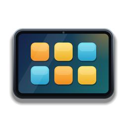

# Phone Bridge – ShopOS x Phone Overhaul



A BepInEx 5 mod for **TCG Card Shop Simulator** that lets
[QOL ShopOS](https://www.nexusmods.com/tcgcardshopsimulator/mods/1754) by Evers665 and
[Phone - Overhaul](https://www.nexusmods.com/tcgcardshopsimulator/mods/685) by Munchmatoast work together.

> **Unofficial bridge.** It is not made or supported by the ShopOS or Phone Overhaul authors.
> Please report bridge problems here in the [issues](../../issues), not to them.

## What it does

- **ShopOS pages as Phone Overhaul apps** – Music, Lights, Trades, Mod Config, Reputation, Rent,
  Events, Price Check, Decoration, Expansion and the ShopOS settings open inside Phone Overhaul.
  ShopOS builds and runs its own pages; the bridge only hands it Phone Overhaul's page container.
- **ShopOS as a Phone Overhaul device** – with Phone Overhaul's `Phone Key Opens = OtherTablet`,
  Tab opens ShopOS and `Open Phone Key` opens Phone Overhaul.
- **"Phone Overhaul" app on the ShopOS tablet** – registered through the official `ShopOSApi.RegisterApp`.
- **ShopOS settings on the phone** – Brightness, "Apps on the home screen" and "Classic screens"
  are read (never written) and applied to Phone Overhaul.
- **Folder preset** – a BepInEx preloader patcher sorts the Phone Overhaul home screen into folders
  once on the first start (with backup); later changes by the player are kept.
- **Translation** – optional `lang_<code>.txt` files for the hosted pages (German included).

## How it treats ShopOS

Agreed with the ShopOS author:

- No ShopOS method is patched (no Harmony patches on ShopOS types).
- No ShopOS config or setting is ever written.
- ShopOS internals (`Tablet`, `OsApps`, `OsPage`, `OsDesktop`) are reached through reflection only
  to build and host the pages. They can change with any ShopOS update – keeping up with them is
  this project's job. If something is missing, the affected part switches itself off and logs it.

## Building

Requirements: Windows with .NET Framework 4.x (`csc.exe` ships with Windows), the game with
BepInEx 5, Phone - Overhaul and QOL ShopOS installed.

```powershell
.\build.ps1 -Game "D:\Games\TCG Card Shop Simulator"            # build + install into the game
.\build.ps1 -Game "..." -NoInstall                              # build only (dist\)
.\package.ps1 -Version 1.0.0                                    # release zips (release\1.0.0\)
```

| Path | Content |
|---|---|
| `src/` | Plugin: `PhoneBridge.cs` (hosting, devices), `Settings.cs` (ShopOS settings on the phone), `Translator.cs` |
| `src_preloader/` | Preloader patcher for the folder preset |
| `assets/` | App icon, drawn by `make_icons.ps1`, embedded in the DLL |
| `lang/` | Translations |

Install and usage for players: see [README.txt](README.txt).

## Credits

- **Evers665** – QOL ShopOS. No ShopOS files or assets are included in this repository.
- **Munchmatoast** – Phone - Overhaul. Integrated through its public API; no Phone Overhaul files are included.
- BepInEx and Harmony.

Licensed under [MIT](LICENSE) (bridge code only).
